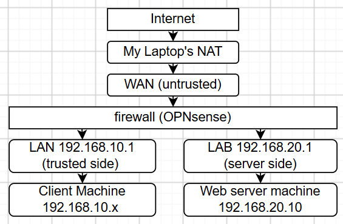
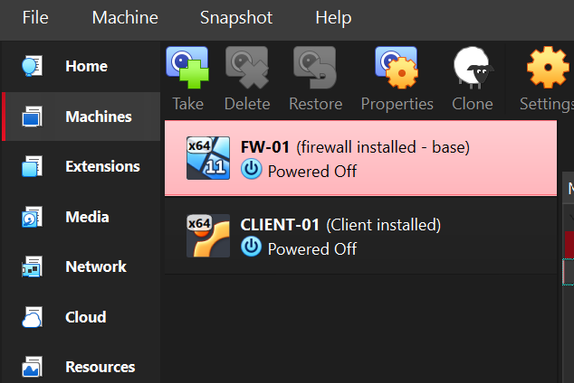
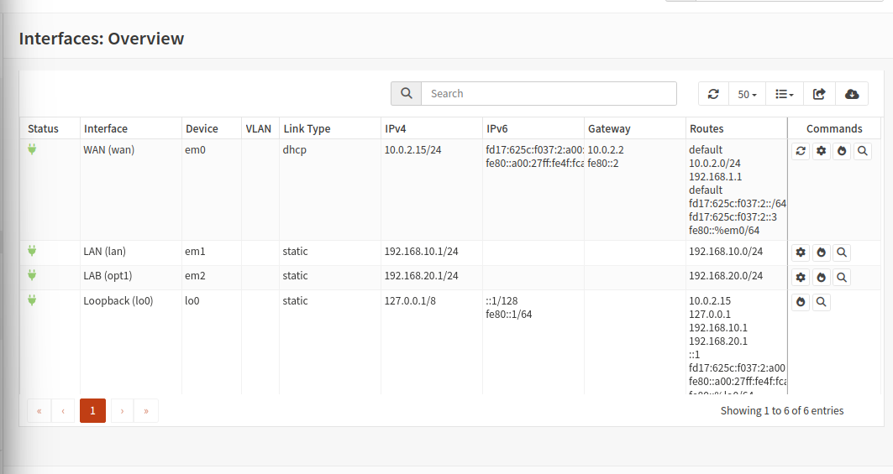
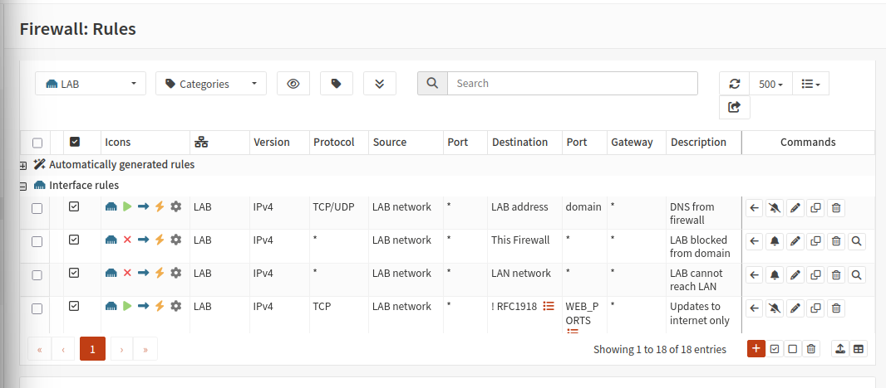
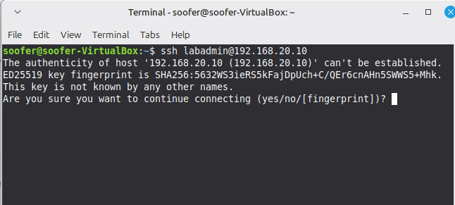

# Home Lab Firewall Project

A segmented virtual network protected by an OPNsense firewall, built in VirtualBox. I wrote default-deny rules, tested them from inside the lab with Nmap, ping and curl, and read the firewall logs to match every result to a rule.

## Key result
The firewall blocked everything except the traffic I allowed. The client could reach the web server on web ports only, and the web server could not reach the LAN or the firewall. Moving one rule out of order let blocked traffic through, which showed me that rule position matters as much as rule content.

## Environment
- Host: Windows 11 laptop, VirtualBox
- Firewall: OPNsense 26.7 (FW-01)
- Client: Linux Mint on the trusted LAN (CLIENT-01)
- Server: Ubuntu Server with Apache on the LAB network (WEB-01)

## Network design

| Zone | Subnet | Firewall IP | Machines |
|------|--------|-------------|----------|
| WAN | 10.0.2.0/24 (VirtualBox NAT) | 10.0.2.15 | None |
| LAN | 192.168.10.0/24 | 192.168.10.1 | CLIENT-01 (192.168.10.150) |
| LAB | 192.168.20.0/24 | 192.168.20.1 | WEB-01 (192.168.20.10) |

The LAN and LAB are separate VirtualBox internal networks, so the only path between them is through the firewall.

## Security requirements
1. LAN clients can browse the internet.
2. LAN clients can reach the web server on web ports only.
3. Only the LAN can open the firewall's admin page.
4. The LAB cannot start connections to the LAN.
5. The LAB cannot reach the firewall's admin page.
6. The LAB can use DNS from the firewall and get updates from the internet.
7. Everything not allowed is blocked, and blocked traffic is logged.

## Firewall rules
Full tables with the reason for each rule are in [rules/rules.md](rules/rules.md).

| Zone | Allowed | Blocked (logged) |
|------|---------|------------------|
| LAN | Admin page, DNS, ping to the gateway, web ports to the web server, internet access | Everything else into the LAB, other firewall services |
| LAB | DNS from the firewall, web ports to the internet (not private ranges) | The firewall's admin page, the whole LAN |

## Testing
Every test, with expected and actual results and screenshots, is in [tests/test-plan.md](tests/test-plan.md).

| Test | Result |
|------|--------|
| Client reaches the internet and the web page | Pass |
| Client pings or SSHes into the LAB | Blocked |
| Web server reaches the LAN or the firewall | Blocked |
| Web server downloads updates | Pass |
| Nmap, client to web server | 80 open, 22 filtered, 443 closed |
| Nmap, web server to client | All filtered |

## Log analysis
The Live View logs showed each blocked connection with the interface, source, destination and the rule that stopped it. For example, an SSH attempt from the client to the web server was blocked by the rule "Everything else in LAB blocked". More entries are explained in [tests/test-plan.md](tests/test-plan.md).

## Rule order experiment
I moved the broad "Internet access" rule above the block rule for the LAB. SSH to the web server then got through. I moved it back and it was blocked again. The block rule was still in the list while the allow rule sat above it, but it never matched, so it protected nothing.

## Problems and fixes
| Problem | Cause | Fix |
|---------|-------|-----|
| OPNsense installer would not boot (UEFI Boot Manager screen) | Secure Boot and UEFI were on, and the installer is not signed for Secure Boot | Turned off both in the VM's System settings |
| Only one network adapter visible | VirtualBox settings were in Basic mode | Switched to Expert mode |
| OPNsense download would not mount | It is a compressed .iso.bz2 file | Extracted it with 7-Zip |
| WAN and LAN reversed after install | OPNsense assigned the interfaces in the opposite order | Reassigned them from the console menu |
| "Can't open machine" error (same UUID) | I tried to open a VM that was already registered | Started it from the VirtualBox list |
| Missing LAB interface (em2) and LAB DHCP range | The third interface needed enabling and a DHCP range | Enabled it and added the range |
| Web server had no address | Its network config had DHCP turned off | Fixed the config and set the address |
| Test page would not update | I split the `tee` command over two lines, so it failed with "Permission denied" | Reran it on one line |
| First "web server to client" test used the wrong address | I used 192.168.10.100, where no machine lives | Reran against the client's real address, 192.168.10.150 |
| Images broke on GitHub | Indented lines, spaces in file names, missing .png | Fixed the paths and file names |

## What I learned
- Rules are checked top to bottom and the first match wins, so I tested the order, not just the content.
- Testing what should be blocked mattered as much as testing what should work.
- "Filtered" and "closed" in Nmap mean different things: one is a firewall dropping packets, the other is a host replying.
- A test against the wrong address proves nothing, so I check the target before trusting a result.

---
All testing was done on virtual machines I own, inside an isolated lab.
