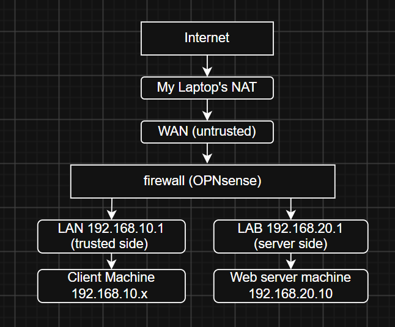

# Home Lab Firewall Project

## Objective
Build a segmented virtual network protected by an OPNsense firewall,
then test the rules and analyse the logs.

## Environment
VirtualBox on Windows 11, OPNsense, Linux Mint (client), Ubuntu Server (web server)

## Network design

| Zone | Subnet | Firewall IP |
|------|--------|-------------|
| WAN  | 10.0.2.0/24 | 10.0.2.15 |
| LAN  | 192.168.10.0/24 | 192.168.10.1 |
| LAB  | 192.168.20.0/24 | 192.168.20.1 |

## Security requirements
## Firewall rules
## Testing
## Log analysis
## Problems and fixes
## Next steps
