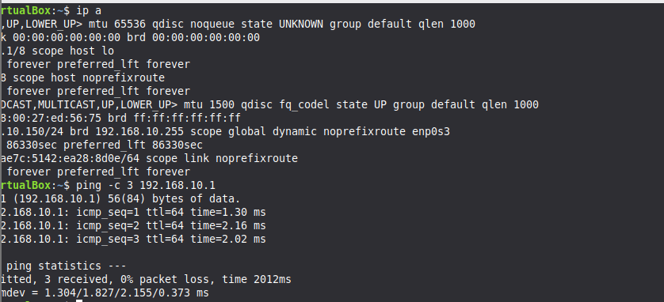
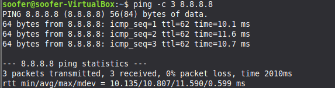
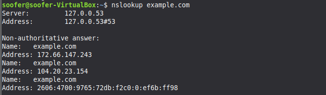
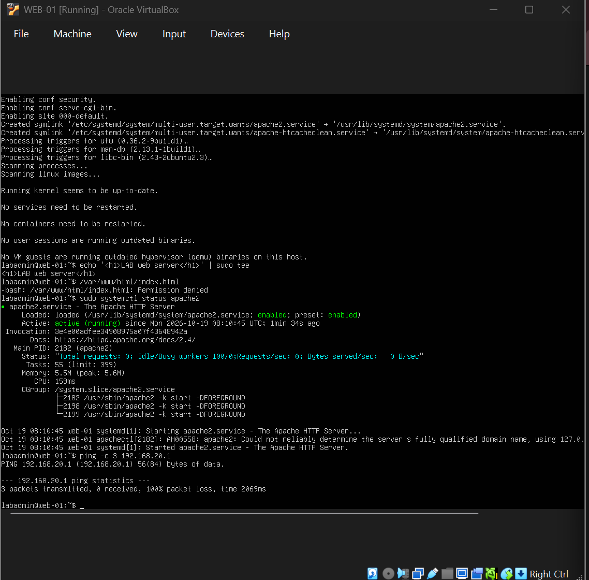
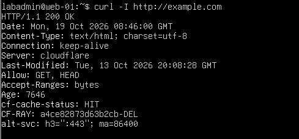
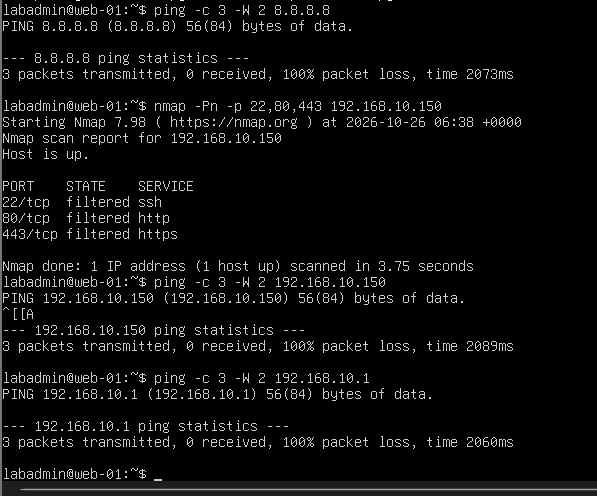
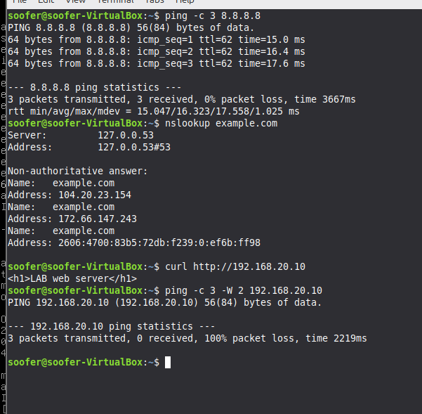
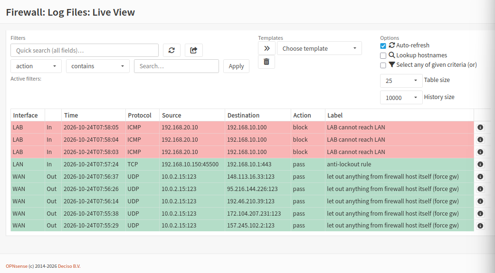

# Test Plan and Results

All tests were run inside my own lab in October 2026. Each test records what I expected,
what happened, and which firewall rule was involved. Nothing outside the lab was
scanned or tested.

**Machines:** CLIENT-01 (192.168.10.150, LAN), WEB-01 (192.168.20.10, LAB), FW-01 (OPNsense)

---

## 1. Baseline tests (before the LAN rules)

Run while the default "allow LAN to any" rule was still in place, to confirm the
network worked before restricting it.

| # | From | Command | Expected | Actual | Result |
|---|------|---------|----------|--------|--------|
| 1 | Client | `ping -c 3 192.168.10.1` | Replies | 3 of 3 replies, 0% loss | PASS |
| 2 | Client | `ping -c 3 8.8.8.8` | Replies | 3 of 3 replies, 0% loss, TTL 62 | PASS |
| 3 | Client | `nslookup example.com` | Returns an IP | Returned IPv4 and IPv6 addresses | PASS |
| 4 | Client | `curl http://192.168.20.10` | Shows the lab page | Printed `<h1>LAB web server</h1>` | PASS |
| 5 | Web server | `ping -c 3 192.168.20.1` | No reply (LAB blocked from admin) | 100% packet loss | PASS |
| 6 | Web server | `ping -c 3 -W 2 8.8.8.8` | No reply (only TCP 80/443 allowed out) | 100% packet loss | PASS |
| 7 | Web server | `curl -I http://example.com` | Gets a response | HTTP/1.1 200 OK | PASS |
| 8 | Web server | `ping -c 3 -W 2 192.168.10.150` | No reply (LAB cannot reach LAN) | 100% packet loss | PASS |
| 9 | Client | `traceroute 192.168.20.10` | First hop is the firewall | Hop 1 OPNsense (192.168.10.1), hop 2 192.168.20.10 | PASS |

### Observations
- The ping to the firewall returned TTL 64, while the ping to the web server returned
  TTL 63. The one-step drop shows the packet was routed through the firewall.
- Tests 5, 6 and 8 were blocked on purpose. The web server can fetch web pages from the
  internet (test 7) but cannot ping the internet, the firewall or the LAN. The
  "Updates to internet only" rule allows TCP on ports 80 and 443, and nothing else.
- At this stage the client could still ping and reach the web server directly. That
  changes after the LAN rules (see T5 below).

---

## 2. Functional tests (after the LAN rules)

Run after replacing the default LAN rule with seven deliberate rules.

| # | From | Command | Expected | Actual | Result |
|---|------|---------|----------|--------|--------|
| T1 | Client | `ping -c 3 8.8.8.8` | Success | 3 of 3 replies, 0% loss, TTL 62 | PASS |
| T2 | Client | `nslookup example.com` | Success | Returned two IPv4 addresses and one IPv6 address | PASS |
| T3 | Client | `curl http://192.168.20.10` | Page loads | Printed `<h1>LAB web server</h1>` | PASS |
| T4 | Client | `ssh labadmin@192.168.20.10` | Times out (blocked) | Hung with no host-key prompt, then timed out. The log shows blocks by "Everything else in LAB blocked" | PASS |
| T5 | Client | `ping -c 3 -W 2 192.168.20.10` | No reply (blocked) | 100% packet loss | PASS |
| T6 | Web server | `ping -c 3 -W 2 192.168.10.150` | No reply | 100% packet loss | PASS |
| T7 | Web server | `ping -c 3 -W 2 192.168.10.1` | No reply (firewall's LAN address) | 100% packet loss | PASS |
| T8 | Web server | `sudo apt update` | Works | Package lists fetched from the Ubuntu mirrors with no errors | PASS |

### Observations
- T3 and T5 together show the rule design. The client can fetch the page (allowed web
  ports) but cannot ping the same server (ICMP is not in the allow list).
- T8 proves two rules at once: DNS from the firewall (the server resolved the Ubuntu
  hostnames) and "Updates to internet only" (the web connections out were allowed).
- The server can reach the internet (T8) but not the LAN or the firewall (T6, T7),
  which is the segmentation I designed.

---

## 3. Nmap scans

| Scan | Command | Expected | Actual | Result |
|------|---------|----------|--------|--------|
| Client to web server | `nmap -Pn -p 22,80,443 192.168.20.10` | 80 open, 22 filtered, 443 closed | 80 open, 22 filtered, 443 closed | PASS |
| Web server to client | `nmap -Pn -p 22,80,443 192.168.10.150` | All filtered | 22, 80 and 443 all filtered | PASS |

What the states mean:
- **open**: a service answered
- **closed**: the host answered "nothing here", so the traffic got through the firewall
- **filtered**: no answer at all, because the firewall dropped the packets

Port 80 is open because the firewall allows web ports to the server and Apache is
listening. Port 443 is closed because the firewall lets the traffic through but Apache
has no HTTPS set up. Port 22 is filtered because the firewall blocks it. One scan
produced three different results, which shows how a firewall decision looks different
from a service that simply is not running.

With `-Pn`, Nmap reports "Host is up" without checking. The scan from the web server
printed "Host is up" even though pings to the same address failed. The result that
matters is that all three ports were filtered, meaning the firewall dropped everything.

---

## 4. Rule order experiment

| Step | What I did | Result |
|------|-----------|--------|
| 1 | SSH from the client with "Internet access (last)" at the bottom of the LAN rules | Blocked, timed out |
| 2 | Moved "Internet access (last)" above "Everything else in LAB blocked" | The host-key prompt appeared, so the connection got through |
| 3 | Moved it back to the bottom | Blocked again, timed out |

**Conclusion:** Rules are checked from the top and the first match wins. When the broad
"allow to any" rule sat above the specific block rule, the block rule was still in the
list but never matched, so it protected nothing. Position matters as much as content.

---

## 5. Log analysis

### SSH from the client to the web server (blocked)

Live View shows eight blocked TCP entries on the LAN interface, from
192.168.10.150:55862 to 192.168.20.10:22, all labelled "Everything else in LAB blocked".
The source port is the same on every line, so these are repeated packets from the same
connection attempt, consistent with the client retrying while no reply came back. From
the client's side this looks like silence, not a rejection, which is how a dropped
packet appears.

### Web server pings the LAN (blocked)

Three ICMP entries on the LAB interface, from 192.168.20.10 to 192.168.10.100, were
blocked by the rule "LAB cannot reach LAN" (one per ping). I had pinged 192.168.10.100
by mistake, an address where no machine lives. The ping failing proves nothing on its
own, but the log shows the rule matched anyway, because it matches on the destination
network (LAN net) and not on a live host. Every address in the LAN is blocked from the
LAB, whether or not a machine is there.

### Web server pings the firewall (blocked)

Three ICMP entries on the LAB interface, from 192.168.20.10 to 192.168.10.1, were
blocked by the rule "LAB blocked from domain" (one per ping). This is the rule meant
to stop the LAB reaching the firewall itself. Its description contains a typo ("domain"
should read "admin"). The address 192.168.10.1 is also inside the LAN network, so the
later rule "LAB cannot reach LAN" would have blocked it too. The log shows the earlier
rule matched first, which is the first-match-wins behaviour from the rule order
experiment.

### An allowed entry: admin page access

The green entry at the bottom of the "Web server pings the LAN" screenshot above shows
my login to the admin page: a pass on the LAN interface from 192.168.10.150:45500 to
192.168.10.1:443. The label is "anti-lockout rule", not my own "Open the admin page"
rule. OPNsense's built-in anti-lockout rule is evaluated before user rules, so it
handles the admin page first. My rule is redundant for that port but documents the
intent.
---

## 6. Problems found while testing

- **Wrong test address:** My first "web server to client" ping targeted 192.168.10.100,
  the start of the DHCP range, with no machine on it. The block still appeared in the
  log, because the rule matches the whole network, but a failed ping to an empty address
  is not evidence by itself. I reran the ping and Nmap scan against the client's real
  address, 192.168.10.150.
- **Web page not updating:** My first attempt to write the test page split the command
  over two lines, so `tee` received no filename and the path on the second line was run
  as a command, which failed with "Permission denied". Apache kept serving its default
  page until I reran the command on one line.

---

## 7. Summary

| Requirement | Evidence | Met |
|-------------|----------|-----|
| LAN can browse the internet | T1, T2 | Yes |
| LAN can reach the web server on web ports only | T3, T5, Nmap client to web server | Yes |
| LAN cannot use other ports into LAB | T4, Nmap, rule order experiment, log analysis | Yes |
| LAB cannot start connections to LAN | Baseline 8, T6, Nmap web to client | Yes |
| LAB cannot reach the firewall | Baseline 5, T7 | Yes |
| LAB can get updates from the internet only | Baseline 6 and 7, T8 | Yes |
| Blocked traffic is logged | Log analysis | Yes |
